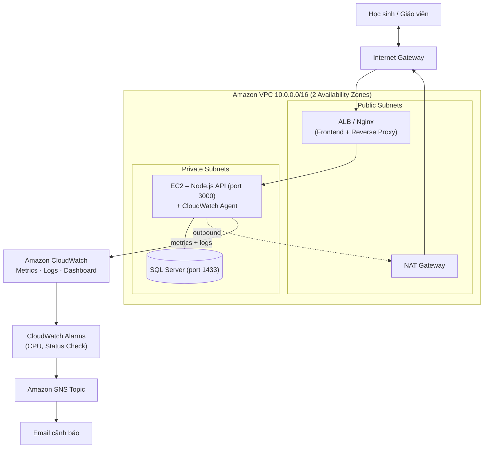
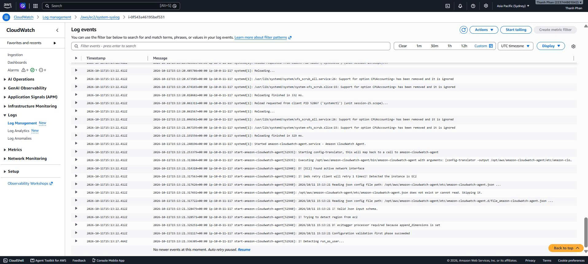
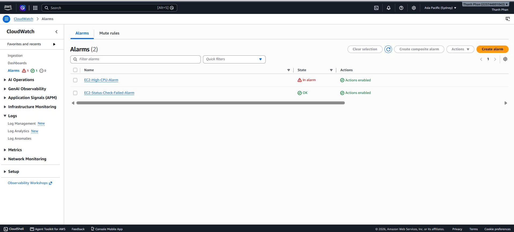
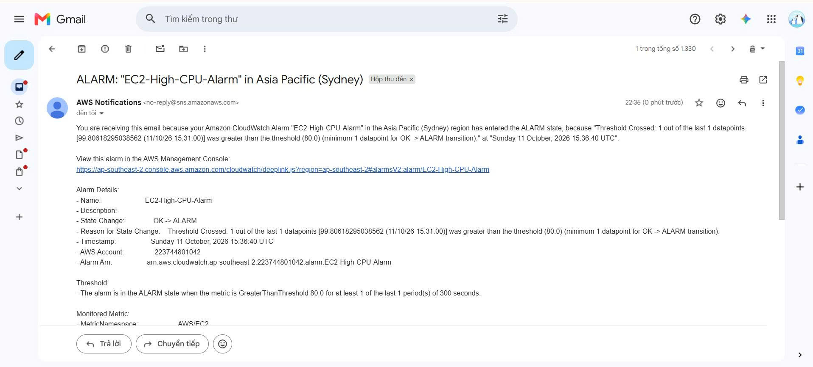
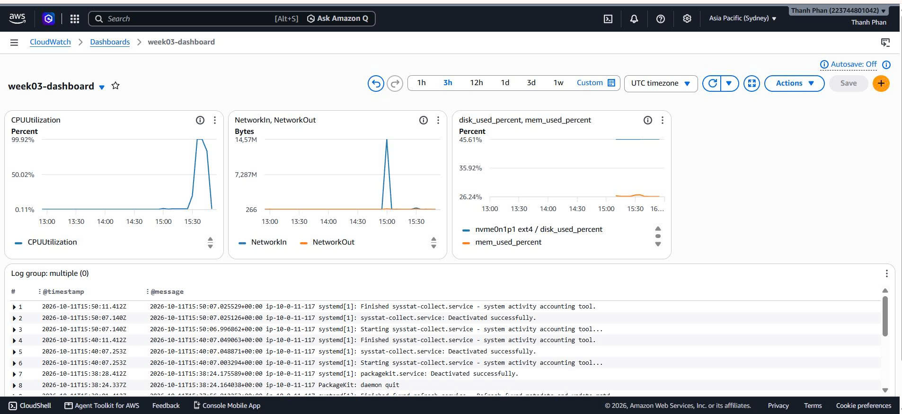

# DOLEARN – Hệ thống thi thử trực tuyến TSA & HSA trên AWS

> Nền tảng thi thử trực tuyến cho kỳ thi Đánh giá tư duy (TSA) và Đánh giá năng lực (HSA), triển khai theo kiến trúc 3 tầng trên Amazon VPC, có giám sát và cảnh báo bằng Amazon CloudWatch.

**Dự án:** AWS 4-Week Challenge

**Website:** https://tsadolearn.duckdns.org/ .

---

## 1. Giới thiệu dự án

### Bài toán
Học sinh luyện thi TSA/HSA thiếu một môi trường giả lập phòng thi thật: ôn luyện các dạng dạng câu hỏi, chấm điểm tự động. Giáo viên cũng cần công cụ để tự soạn đề và quản lý khoá học.

### Giải pháp
- Học sinh đăng ký/đăng nhập, xác thực tài khoản và đặt lại mật khẩu qua email.
- Làm bài thi trắc nghiệm đa dạng hình thức (chọn đáp án, điền số, kéo thả, đúng sai) như khi đi thật.
- Tự động chấm điểm, lưu lịch sử làm bài, thống kê tiến độ.
- Trang quản trị cho giáo viên: tạo/sửa/xoá đề thi và khoá học, tải ảnh lên.

### Công nghệ

| Tầng | Công nghệ |
|---|---|
| Frontend | HTML, CSS, JavaScript |
| Backend | Node.js, Express  |
| Database | MySQL |
| Hạ tầng | Amazon VPC, EC2, NAT Gateway, Security Group |
| Giám sát | CloudWatch Agent, Logs, Metrics, Alarms, Dashboard, SNS |

### Kiến trúc tổng quan



**Nguyên tắc thiết kế:**
- **Network Isolation:** chỉ ALB/Nginx và NAT Gateway nằm ở Public Subnet. Backend và Database nằm hoàn toàn trong Private Subnet, không có Public IP.
- **Defense in Depth:** Internet → ALB/Nginx → API → Database; mỗi tầng chỉ nhận traffic từ tầng liền trên qua Security Group.
- **Outbound có kiểm soát:** server trong Private Subnet muốn ra Internet (cài npm, cập nhật OS) phải đi qua NAT Gateway, chỉ cho đi ra, không cho đi vào.

Chi tiết thiết kế mạng: [`week-01/notes.md`](./week-01/notes.md) · Luồng gói tin và Security Group: [`week-02/notes.md`](./week-02/notes.md)

---

## 2. Hướng dẫn triển khai (Deployment Guide)

### Yêu cầu
- Tài khoản AWS (region đang dùng: `ap-southeast-2` – Sydney)
- Một địa chỉ email để nhận cảnh báo SNS
- Node.js 18+ và SQL Server (hoặc SQL Server Express)

### Bước 1 – Tạo hạ tầng mạng
1. Tạo VPC `10.0.0.0/16`.
2. Tạo 2 Public Subnet và 2 Private Subnet, mỗi loại trải trên 2 AZ.
3. Gắn Internet Gateway; Route Table của Public Subnet trỏ `0.0.0.0/0` về IGW.
4. Tạo NAT Gateway ở Public Subnet; Route Table của Private Subnet trỏ `0.0.0.0/0` về NAT.

### Bước 2 – Cấu hình Security Group

| SG | Chiều | Cổng | Nguồn | Mục đích |
|---|---|---|---|---|
| Public (ALB/Nginx) | Inbound | 80, 443 | `0.0.0.0/0` | Nhận traffic người dùng |
| Public (ALB/Nginx) | Inbound | 22 | IP cá nhân `/32` | SSH quản trị (tuỳ chọn) |
| Private (App) | Inbound | 3000 | SG Public | Chỉ nhận request từ Nginx/ALB |
| Private (DB) | Inbound | 1433 | SG App | Chỉ cho Node.js truy cập SQL Server |

### Bước 3 – Cơ sở dữ liệu
Cài SQL Server ở Private Subnet, tạo database `DB_ThiTsaHsa` và các bảng cần thiết.

### Bước 4 – Triển khai Backend (Node.js)
```bash
cd week-04/src/Backend
npm install
cp .env.example .env     # điền thông tin kết nối DB và SMTP
node server.js           # lắng nghe tại cổng 3000
```

### Bước 5 – Triển khai Frontend (Nginx)
Cài Nginx trên EC2 ở Public Subnet, đặt mã nguồn Frontend vào thư mục web root và cấu hình reverse proxy `/api` về Backend ở Private Subnet (cổng 3000).

### Bước 6 – Cấu hình giám sát CloudWatch
1. Gắn IAM Role với policy `CloudWatchAgentServerPolicy` cho EC2.
2. Cài và chạy CloudWatch Agent với file cấu hình [`week-03/src/amazon-cloudwatch-agent.json`](./week-03/src/amazon-cloudwatch-agent.json):
```bash
   sudo /opt/aws/amazon-cloudwatch-agent/bin/amazon-cloudwatch-agent-ctl \
     -a fetch-config -m ec2 -s \
     -c file:/opt/aws/amazon-cloudwatch-agent/etc/amazon-cloudwatch-agent.json
```
   Agent thu thập CPU, RAM (`mem_used_percent`), ổ đĩa (`used_percent`) mỗi 60 giây và đẩy `/var/log/syslog` lên CloudWatch Logs (giữ 7 ngày).
3. Tạo SNS Topic (Standard), đăng ký email và **xác nhận** email AWS gửi tới.
4. Tạo 2 CloudWatch Alarm gửi về SNS Topic:
   - `EC2-High-CPU-Alarm`: `CPUUtilization` > 80% trong 300 giây.
   - `EC2-Status-Check-Failed-Alarm`: Status Check thất bại.
5. Tạo Dashboard `week03-dashboard` gồm CPU, Network In/Out, Disk/RAM và widget Logs.

---

## 3. Hướng dẫn kiểm thử (Verification)

### Kiểm tra ứng dụng

| Việc cần test | Cách làm | Kết quả mong đợi |
|---|---|---|
| Truy cập trang chủ | Mở https://tsadolearn.duckdns.org/ | Chuyển tới `/home/index.html` |
| Lấy danh sách khoá học | `curl https://tsadolearn.duckdns.org/api/courses` | JSON có `success: true` |
| Lấy danh sách đề thi | `curl https://tsadolearn.duckdns.org/api/exams` | JSON danh sách đề |
| Đăng nhập | Mở `/auth.html?mode=login` và đăng nhập (`POST /api/login`) | Đăng nhập thành công, vào dashboard |
| Trang quản trị | Mở `/admin/admin-list.html` (trang quản trị đề thi) | Hiển thị danh sách đề thi |

### Kiểm tra hệ thống giám sát
1. **Logs:** CloudWatch → Log groups → mở log stream của instance, thấy log hệ thống và dòng khởi động của CloudWatch Agent.
2. **Metrics:** CloudWatch → Metrics → namespace `CWAgent`, thấy `mem_used_percent`, `disk_used_percent`.
3. **Dashboard:** mở `week03-dashboard`, thấy biểu đồ CPU, Network, Disk/RAM và log.
4. **Alarm + Email:** tạo tải CPU cao (ví dụ `stress`) hoặc dùng `aws cloudwatch set-alarm-state`. Alarm chuyển `OK → ALARM` và email cảnh báo về hộp thư.

### Ảnh minh chứng (Tuần 3)

**CloudWatch Logs**


**CloudWatch Alarms**


**Email cảnh báo từ SNS**


**CloudWatch Dashboard**


Ảnh minh chứng triển khai Frontend ở Tuần 2: [`week-02/screenshots.md`](./week-02/screenshots.md)

---

## 4. Tổng kết 4 tuần

### Công nghệ AWS đã ứng dụng

| Tuần | Nội dung | Dịch vụ / khái niệm AWS |
|---|---|---|
| 1 | Thiết kế mạng, đăng ký ý tưởng | VPC, Public/Private Subnet, IGW, NAT Gateway, Security Group, NACL |
| 2 | Triển khai ứng dụng | EC2, Nginx, Security Group, luồng Inbound/Outbound |
| 3 | Giám sát và cảnh báo | CloudWatch Agent, Logs, Metrics, Alarms, Dashboard, SNS, AWS Budgets |
| 4 | Hoàn thiện, bảo mật, đóng gói | Rà soát bảo mật, dọn dẹp Free Tier, tài liệu và demo |

### Bài học kinh nghiệm
- **Thiết kế mạng trước, triển khai sau:** tách Public/Private Subnet từ đầu giúp bảo vệ Backend và Database ngay từ kiến trúc.
- **Security Group là stateful, NACL là stateless:** với NACL phải mở thêm cổng ephemeral (1024–65535) cho chiều phản hồi.
- **Metrics và Logs bổ trợ nhau:** Metric báo "cái gì sai, từ khi nào", Log cho biết "vì sao sai". Muốn alarm theo log cần Metric Filter.
- **Subscription SNS phải được confirm:** chưa confirm thì không nhận được email cảnh báo.
- **Kiểm soát chi phí:** đặt retention cho Log Group, dọn NAT Gateway, EBS, Elastic IP không dùng, và đặt AWS Budgets.
- **Không để mật khẩu trong mã nguồn:** thông tin nhạy cảm phải nằm trong biến môi trường hoặc dịch vụ quản lý bí mật, không đưa lên GitHub.

---

## Cấu trúc repository

```
aws-4week-challenge/
├── README.md
├── week-01/    # Thiết kế VPC, ý tưởng sản phẩm
├── week-02/    # Ứng dụng (Backend + Frontend), Security Group, ảnh triển khai
├── week-03/    # CloudWatch Agent, Alarms, SNS, Dashboard, ảnh minh chứng
└── week-04/
    ├── src/    # Mã nguồn bản hoàn thiện
    └── demo/   # Video demo
```
