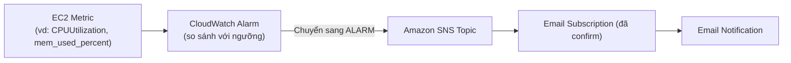

# Phần 1: Lý thuyết & Kiến thức Vận hành

## 1. Phân biệt Metrics & Logs

**Observability** là khả năng hiểu trạng thái bên trong hệ thống thông qua dữ liệu mà nó phát ra. Ba trụ cột chính: **Metrics, Logs, Traces**. Tuần này tập trung vào Metrics và Logs.

| Tiêu chí | Metrics (Chỉ số) | Logs (Nhật ký sự kiện) |
| :--- | :--- | :--- |
| **Định nghĩa** | Dữ liệu số đo lường hiệu năng hệ thống theo thời gian (time-series data). | Các bản ghi (text/JSON) ghi lại sự kiện cụ thể xảy ra trong hệ thống tại một thời điểm. |
| **Điểm cốt lõi** | Mang tính **định lượng**: hệ thống đang chạy nhanh/chậm ra sao, tốn bao nhiêu tài nguyên? | Mang tính **định tính**: đã xảy ra lỗi gì, tại sao lỗi, ai đã gọi API? |
| **Độ chi tiết** | Dữ liệu tổng hợp (aggregate), ít ngữ cảnh. | Rất chi tiết, đầy đủ ngữ cảnh từng sự kiện. |
| **Dung lượng & Chi phí** | Nhẹ, dễ lưu trữ dài hạn, chi phí rẻ. | Rất lớn, tăng nhanh theo lưu lượng traffic, chi phí lưu trữ cao. |
| **Ví dụ** | `CPUUtilization`, `mem_used_percent`, `disk used_percent` | `/var/log/messages`, access log của Nginx, application error log |
| **Vai trò trong Observability** | Phát hiện bất thường nhanh (Detection) và kích hoạt cảnh báo tự động (Alarming). | Điều tra tận gốc nguyên nhân (Root Cause Analysis / Debugging). |

**Mối quan hệ bổ trợ:** Metrics cho biết **"cái gì sai, từ khi nào"**; Logs trả lời **"tại sao sai"**.
Quy trình thực tế: Metric báo bất thường ➔ Alarm kích hoạt ➔ mở Logs xem chi tiết ➔ khắc phục.

---

## 2. Cơ chế hoạt động của CloudWatch Agent

### 2.1. Vì sao cần Agent?

- EC2 mặc định gửi về CloudWatch các metric ở **tầng hypervisor**: CPU, Network, Disk I/O, Status Check (chu kỳ 5 phút; bật Detailed Monitoring để có chu kỳ 1 phút).
- Hypervisor **không nhìn được vào bên trong hệ điều hành (Guest OS)**, nên các chỉ số như **RAM, Disk Space, Swap...** không có sẵn.
- **CloudWatch Agent** là phần mềm cài bên trong OS của EC2 để thu thập các chỉ số này và đẩy log file lên CloudWatch Logs.

### 2.2. Cơ chế hoạt động

- **Thu thập (Collection):** Agent chạy ngầm (daemon/service), định kỳ đọc thông tin hệ thống (`/proc` trên Linux hoặc Performance Counters trên Windows) để lấy **System Metrics** chuyên sâu (RAM, Disk space, Swap...). Đồng thời nó theo dõi (tail) các file log được chỉ định (ví dụ `/var/log/nginx/access.log`).
- **Đóng gói & Đệm (Batching/Buffering):** Dữ liệu được gom thành lô (batch) để giảm số lượng request gửi đi.
- **Đẩy dữ liệu (Pushing):** Agent dùng quyền của **IAM Role gắn vào EC2** để gọi API `PutMetricData` (metrics) và `PutLogEvents` (logs) qua HTTPS tới CloudWatch.
- **Nơi lưu trữ kết quả:**
  - System Metrics ➔ **CloudWatch Metrics**, namespace mặc định `CWAgent`.
  - Log file ➔ **CloudWatch Logs**, theo cấu trúc *Log Group / Log Stream*.

### 2.3. Các bước triển khai (Linux)

1. **Gắn IAM Role** cho EC2 với policy `CloudWatchAgentServerPolicy`.
2. **Cài Agent** (Amazon Linux): `sudo yum install -y amazon-cloudwatch-agent`
3. **Tạo file cấu hình** bằng wizard: `sudo /opt/aws/amazon-cloudwatch-agent/bin/amazon-cloudwatch-agent-config-wizard` (hoặc viết JSON tay; hoặc lưu cấu hình trên SSM Parameter Store để dùng chung nhiều instance).
4. **Khởi động Agent** với file cấu hình:
   ```bash
   sudo /opt/aws/amazon-cloudwatch-agent/bin/amazon-cloudwatch-agent-ctl \
     -a fetch-config -m ec2 -s \
     -c file:/opt/aws/amazon-cloudwatch-agent/bin/config.json
   ```
5. **Kiểm tra:** CloudWatch ➔ Metrics ➔ namespace `CWAgent`; CloudWatch ➔ Log groups.

### 2.4. Ví dụ file cấu hình tối giản

```json
{
  "metrics": {
    "metrics_collected": {
      "mem":  { "measurement": ["mem_used_percent"] },
      "disk": { "measurement": ["used_percent"], "resources": ["/"] }
    },
    "append_dimensions": { "InstanceId": "${aws:InstanceId}" }
  },
  "logs": {
    "logs_collected": {
      "files": {
        "collect_list": [
          {
            "file_path": "/var/log/messages",
            "log_group_name": "ec2-system-logs",
            "log_stream_name": "{instance_id}"
          }
        ]
      }
    }
  }
}
```

> **Lưu ý:** Custom metric của Agent và việc ingest/lưu log đều **tính phí**. Chỉ thu thập những gì cần thiết và đặt **retention** cho Log Group.

---

## 3. Quy trình Cảnh báo (Alerting Workflow)

Sơ đồ luồng sự kiện:

```
[EC2 Metric] --> [CloudWatch Alarm] --(trạng thái ALARM)--> [Amazon SNS Topic] --> [Email Notification]
```



- **Bước 1 – EC2 Metric:** EC2 (hoặc CloudWatch Agent) gửi dữ liệu về CloudWatch theo chu kỳ. Ví dụ `CPUUtilization` đạt 85%.
- **Bước 2 – CloudWatch Alarm:** Alarm liên tục đánh giá metric theo điều kiện đã cấu hình.
  - Tham số chính: **Statistic** (Average/Max...), **Period**, **Threshold**, **Evaluation Periods**, **Datapoints to alarm**.
  - Ví dụ "CPU > 80% trong 5 phút": Period = 5 phút, Evaluation Periods = 1 (hoặc Period = 1 phút, 5 datapoints liên tiếp).
  - Ba trạng thái: `OK`, `ALARM`, `INSUFFICIENT_DATA`.
- **Bước 3 – Amazon SNS Topic:** Khi chuyển sang `ALARM`, alarm kích hoạt Action publish message lên SNS Topic.
- **Bước 4 – Email Notification:** SNS gửi message tới tất cả subscriber của Topic (các email đã confirm) ➔ người vận hành nhận được email cảnh báo.

**Các bước thiết lập:**

1. Tạo **SNS Topic** (loại Standard) ➔ tạo **Subscription** với giao thức `Email` và địa chỉ nhận.
2. **Confirm subscription** qua email AWS gửi tới. Chưa confirm (trạng thái *Pending confirmation*) thì sẽ không nhận được cảnh báo.
3. Tạo **CloudWatch Alarm** trên metric cần giám sát, chọn action thông báo tới SNS Topic vừa tạo.
4. **Test:** tạo tải giả (ví dụ công cụ `stress`) hoặc dùng lệnh `aws cloudwatch set-alarm-state` để kiểm tra email có về không.

> **Ghi chú:** Log **không** đi vào CloudWatch Metrics trực tiếp mà vào **CloudWatch Logs**. Muốn đặt alarm dựa trên log (ví dụ đếm số dòng `ERROR`), cần tạo **Metric Filter** để chuyển log thành metric, rồi mới tạo Alarm trên metric đó.

---

## 4. Kiểm soát Chi phí (Cost Control) với AWS Budgets

AWS Budgets cho phép đặt ngân sách và gửi cảnh báo khi chi phí vượt ngưỡng. Lưu ý quan trọng: Budgets chủ yếu là công cụ **cảnh báo**, **không tự động chặn cứng** chi tiêu (trừ khi cấu hình Budget Actions), và dữ liệu chi phí **có độ trễ**, không phải realtime.

**Các biện pháp thiết lập:**

1. **Tạo Cost Budget hàng tháng** với mức tối đa chấp nhận được (ví dụ $10/tháng cho môi trường học tập).
2. **Cấu hình nhiều ngưỡng cảnh báo (Thresholds):**
   - **Actual (Thực tế):** 50% hoặc 80% ngân sách ➔ cảnh báo sớm; 100% ➔ báo động cuối.
   - **Forecasted (Dự báo):** 100% ➔ gửi mail ngay khi AWS dự báo chi phí cuối tháng có khả năng vượt ngân sách.
3. **Kênh nhận cảnh báo:** email trực tiếp hoặc **SNS Topic** (có thể tái sử dụng luồng SNS ở mục 3).
4. **Zero-spend budget:** cảnh báo ngay khi phát sinh bất kỳ khoản phí nào (hữu ích khi dùng Free Tier).
5. **Budget Actions (nâng cao, tuỳ chọn):** tự động áp IAM/SCP policy giới hạn quyền, hoặc dừng EC2/RDS khi chi phí chạm ngưỡng (có thể chạy tự động hoặc cần phê duyệt thủ công).
6. **Công cụ bổ trợ:** bật **Cost Anomaly Detection** để phát hiện chi tiêu bất thường; dùng **Cost Explorer** để xem chi phí theo dịch vụ.

**Thói quen vận hành để tránh phát sinh chi phí:**

- Dừng/terminate EC2 không dùng; xoá EBS volume, snapshot, Elastic IP không gắn, NAT Gateway, Load Balancer thừa.
- Đặt **retention** cho CloudWatch Log Group, tránh lưu log vô hạn.
- Gắn **Tag** cho tài nguyên để theo dõi chi phí theo dự án.
- Kiểm tra Billing Dashboard định kỳ.
